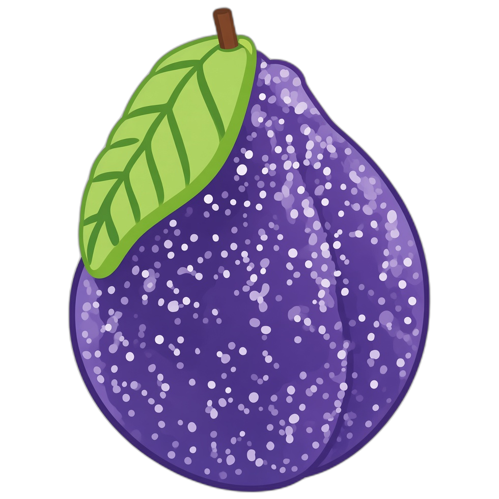

# Sugarplum

<p align="center">
  
</p>

[](https://workers.cloudflare.com/)
[](https://web.dev/progressive-web-apps/)
[](https://react.dev/)
[](https://mui.com/)
[](https://github.com/open-spaced-repetition/ts-fsrs)

Spaced-repetition study app that turns lecture notes and PDFs into flashcards, then schedules reviews so you remember them.

**App:** [https://sugarplum.gelbhart.dev](https://sugarplum.gelbhart.dev)

## What it does

- Paste study materials or upload a text PDF
- Generate draft cards (Q&A and cloze), then edit before they enter your deck
- Study with FSRS spaced repetition
- Sign in with email/password or Google

## Develop

```bash
npm install
npm run dev
```

`prebuild` fetches layout and OCR assets (`scripts/fetch-layout-assets.mjs`, `scripts/fetch-ocr-assets.mjs`).

## Deploy

GitHub Actions on `main` runs tests, applies remote D1 migrations, and deploys with Wrangler. Required Actions secrets: `CLOUDFLARE_API_TOKEN`, `CLOUDFLARE_ACCOUNT_ID`. Worker secrets (Cloudflare, not GitHub) include wrap key, R2 keys, Google OAuth, and Turnstile as needed for your environment.

Live site: [https://sugarplum.gelbhart.dev](https://sugarplum.gelbhart.dev).

## Attribution

Fruit achievement medal artwork: [designed by vector4stock - Magnific.com](https://www.magnific.com). License certificate: [`docs/licenses/magnific-25333978.pdf`](docs/licenses/magnific-25333978.pdf).
